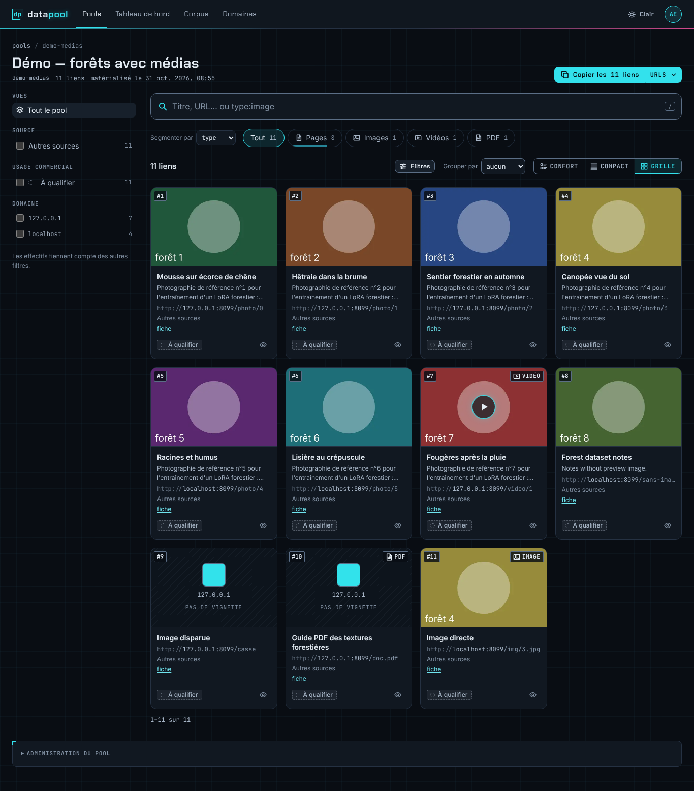
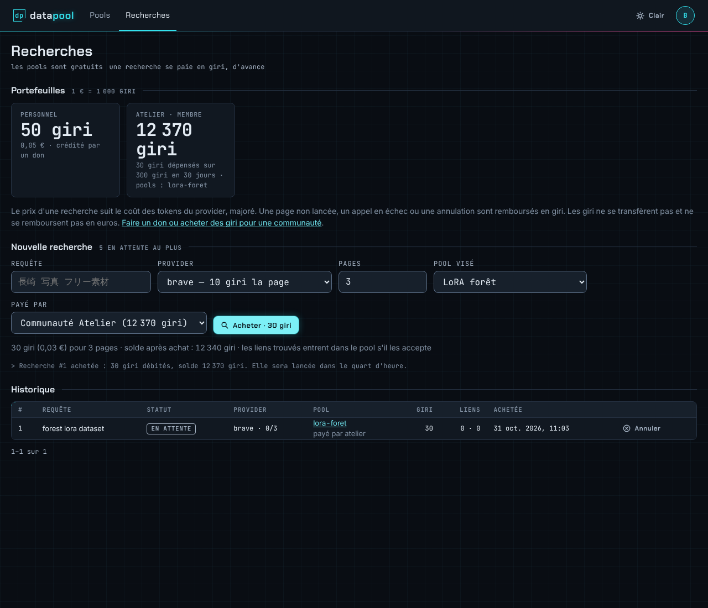

# datapool

Interface web de [webpool](https://github.com/RebelliousSmile/webpool) : pools,
corpus, domaines et activité du pipeline, lus par l'API HTTP de webpool
(`webpool serve`). L'interface consulte, et achète des recherches payantes ;
elle ne modifie ni les pools ni le corpus.



## Accès

**[datapool.scriptami.com](https://datapool.scriptami.com)**, branché sur l'API
`https://webpool.scriptami.com/api/v1` (préremplie dans le formulaire de connexion).

L'accès se fait sur invitation, sans inscription en libre-service. Le
formulaire de connexion propose trois onglets :

- **Compte** : e-mail et mot de passe. La session dure 30 jours.
- **Activation** : à la première visite, l'e-mail, le code d'invitation remis
  par l'admin (`webpool account invite`, valable 7 jours, usage unique) et un
  mot de passe de 12 caractères au moins. Aucun e-mail n'est envoyé : l'admin
  transmet le code lui-même.
- **Jeton d'API** : l'URL de l'API et un jeton brut (`webpool client add`),
  toujours accepté, pour l'admin comme pour un script.

Une session de compte change son mot de passe depuis « Mon compte » (menu de
l'avatar) ; les autres sessions du compte sont alors fermées. Selon le scope du
client, on voit :

| Scope | Pools visibles |
|---|---|
| `read` (client) | pools publics (marqués « public »), pools accordés à ce client (`webpool client grant`), pools des communautés dont il est membre |
| `admin` | tous les pools, plus le tableau de bord, le corpus, les fiches URL et les domaines |

Un client `read` ne voit ni la définition ni les scores d'un pool. Les pools
sont gratuits ; les recherches se paient en giri, voir
[webpool](https://github.com/RebelliousSmile/webpool#recherches-payantes--dons-et-giri).

Le jeton (ou la session de compte) reste dans le `localStorage` du navigateur.
« Déconnexion » l'efface et ferme la session côté API ; un jeton révoqué ou une
session expirée aussi, même en cours de session : au premier 401, le
formulaire de connexion revient avec un message. Chaque appel à l'API abandonne
après 15 s (« L'API ne répond pas »).

## Écrans

| Écran | Accès | Contenu |
|---|---|---|
| Tableau de bord | admin | volumes du corpus, liens en quarantaine, pools, domaines à qualifier, frontière d'exploration, derniers runs |
| Pools | admin, read | cartes des pools visibles : mosaïque des premières vignettes, répartition par usage commercial, nombre de liens, date de matérialisation ; chaque pool s'ouvre en outil de recherche (ci-dessous) |
| Recherche | admin, read | barre de l'en-tête (touche `/`) : un terme cherché dans tous les pools visibles (titre, description, URL), un résultat par lien avec les pools qui le contiennent et son rang dans chacun |
| Mon compte | session de compte | changement de mot de passe |
| Recherches | admin, read | soldes en giri, achat de recherches, historique, communautés (ci-dessous) |
| Corpus | admin | URLs filtrées (texte, statut, thème, domaine, quarantaine), triées par date, qualité ou pertinence ; copie ou téléchargement de la sélection (5 000 liens au plus, plafond annoncé) |
| Fiche URL | admin | sources (requête, provider, rang), thèmes, facettes, pools ; contrôle des liens : quarantaine, dernier test et historique des contrôles |
| Domaines | admin | registre, filtré par usage commercial (dont « à qualifier ») |

### Pool

- **Barre de requête à jetons** (`type:image usage:libre`, touche `/` pour y
  aller) et **facettes comptées** : type de média, source, usage, domaine.
- Onglets de segments, « Grouper par » avec « Copier ce groupe », trois
  densités (confort, compact, grille), aperçu d'un lien, vues enregistrées.
- **Copie ou téléchargement de la sélection** : URLs seules par défaut,
  Markdown ou CSV.
- Chaque lien montre sa vignette et le favicon de son site (servis par le cache
  de webpool), sa description, son type de média et sa famille de source.
- L'état de l'explorateur vit dans l'URL : un lien copié rouvre la même vue.
- Pour l'admin : fiche de chaque lien, synthèse, définition et export.

### Recherches

Accessible aussi depuis un pool par « ajouter une recherche à ce pool ».

- **Soldes** : portefeuille personnel (crédité par un don) et pot de chaque
  communauté (rôle, plafond, dépense sur 30 jours, vos apports).
- **Achat** : requête, provider, nombre de pages, pool visé, avec le prix et le
  solde après achat. Un pool de communauté se paie sur son pot, jamais en
  personnel.
- **Historique** filtrable par statut : giri dépensés après remboursement, liens
  trouvés, nouveaux et entrés dans le pool ; annulation d'une recherche en
  attente. **Mouvements** repliables : grand livre personnel, ou du pot pour un
  propriétaire.
- **Communautés** : invitations reçues (accepter, décliner), « Quitter » avec
  confirmation. Les propriétaires voient les recherches de leur communauté et
  gèrent ses membres (invitation, rôle, plafond, retrait ; « invité » tant que
  l'invitation n'est pas acceptée). L'admin voit toutes les recherches.

**Achat sûr.** Un achat à la fois (le bouton passe à « Achat… »). Chaque achat
part avec un en-tête `Idempotency-Key` : si la connexion tombe ou si l'API ne
répond pas dans les 15 s, relancer le même achat renvoie la même clé, et webpool
rend la recherche déjà achetée sans débiter une seconde fois (« déjà achetée,
rien de plus débité »). Une annulation en cours désactive son bouton. Après un
refus pour solde (402) ou file pleine (429), les soldes sont relus ; si cette
relecture échoue après un achat, l'achat reste affiché et l'erreur apparaît en
alerte au-dessus des soldes.



## Direction artistique

« Data Pool » : terminal d'accès au Net, sombre par défaut (thème clair au
choix, mémorisé). Jetons, polices libres (Chakra Petch, JetBrains Mono, SIL OFL)
et styles (`src/styles/`) viennent des maquettes v2 de la branche
`design/data-pool` (commit `8b63daa`) ; maquettes, feuille de composants et
captures sont dans `design/`. La palette d'usage commercial est vérifiée pour
les daltoniens, et chaque usage porte aussi une forme et un libellé.

## Lancer en local

```bash
# côté webpool
pnpm webpool client add --name moi --scope admin     # note le jeton affiché
pnpm webpool account invite --name ana --email ana@ex.fr   # ou un compte : note le code d'invitation
WEBPOOL_API_CORS_ORIGINS=http://localhost:5173 pnpm webpool serve

# côté datapool
pnpm install
pnpm dev            # http://localhost:5173 : saisir l'URL de l'API et le jeton
```

L'URL d'API proposée vient de `VITE_WEBPOOL_API_URL` (voir `.env.example`),
sinon `http://127.0.0.1:3000/api/v1`.

## Construction et hébergement

```bash
pnpm build          # site statique dans build/, repli index.html pour les routes
pnpm preview
```

`build/` se sert tel quel par n'importe quel serveur statique, à condition de
renvoyer `index.html` pour les chemins inconnus (application monopage).
L'origine de datapool doit figurer dans `WEBPOOL_API_CORS_ORIGINS` côté webpool.

Le jeton étant lisible par les scripts de la page, l'interface ne charge aucune
ressource tierce ; poser une `Content-Security-Policy` à l'hébergement.

## Déploiement (alwaysdata)

L'instance publique (`datapool.scriptami.com`) est un site *Fichiers statiques*
alwaysdata, déployé par `scripts/deploy.mjs`, sur le même modèle que webpool.

**Préparation, une fois :**

- dans l'admin, *Web > Sites* : un site de type *Fichiers statiques* sur un
  sous-domaine, racine `www/datapool` ;
- côté webpool, l'origine du site dans `WEBPOOL_API_CORS_ORIGINS` de
  `~/www/webpool.env` (sans `/` final), puis redémarrage du site de l'API ;
- en local, la cible, dans un fichier ignoré par git (la clé SSH de webpool
  convient) :

```bash
cp deploy/targets.example.json deploy/targets.json   # host, user, sshKey, siteUrl, apiUrl…
```

Pour l'instance publique : `siteUrl` = `https://datapool.scriptami.com`,
`apiUrl` = `https://webpool.scriptami.com/api/v1`.

**Déployer** depuis Windows (WSL avec Node, `rsync`, `ssh` et pnpm dans `~/.local/bin`) :

```bash
pnpm deploy:prod ad --check     # archive du commit + build en staging WSL, sans contacter la cible
pnpm deploy:prod ad             # prévisualisation : garde, CORS de webpool, fichiers modifiés
pnpm deploy:prod ad --apply     # livraison
```

Seul le commit `HEAD` de `main` part (`git archive`), jamais la copie de
travail. Le build fige `apiUrl` dans `VITE_WEBPOOL_API_URL`. Avant toute
mutation, le script lit sur la cible `WEBPOOL_API_CORS_ORIGINS` dans
`~/www/webpool.env` (seule cette clé sort du fichier) et refuse si l'origine du
site n'y figure pas.

Le script génère le `.htaccess` :

- repli de toutes les routes vers `index.html` ;
- CSP : `connect-src` et `img-src` limités à l'API, empreintes des scripts en
  ligne de `index.html`, `style-src 'self'` sans `<style>` en ligne.
  L'application ne pose aucun `style=""` (les `style:` de Svelte passent par le
  CSSOM, que la CSP laisse faire) ; seul l'annonceur de navigation de SvelteKit
  en porte un, d'où `style-src-attr 'unsafe-inline'` ;
- HSTS (`max-age=31536000`), `Permissions-Policy` (caméra, micro,
  géolocalisation, paiement refusés) ;
- cache immuable pour `_app/immutable/`.

`--apply`, sous verrou (`~/deploy/datapool-ad/lock`) et garde de cycle de vie,
synchronise dans `~/www/datapool.new` (droits 755/644 vérifiés), bascule vers
`~/www/datapool`, puis vérifie que `/` et `/pools` répondent 200 avec la CSP
attendue. La version précédente reste dans `~/www/datapool.old` jusqu'au
déploiement suivant ; la commande de restauration est affichée en fin de run.

## Contrat d'API

Les types TypeScript de l'API sont générés depuis `webpool/openapi.json`, attendu
dans un dossier voisin (`../webpool`) :

```bash
pnpm api:types      # → src/lib/api/schema.d.ts (versionné, ne pas éditer)
```

## Développement

```bash
pnpm lint           # ESLint (TypeScript, Svelte)
pnpm check          # svelte-check (types)
pnpm test           # vitest : client d'API, session, mise en forme, composants (jsdom)
pnpm test:coverage  # idem avec couverture de src/lib et planchers (rapport dans coverage/)
```

La CI (`.github/workflows/ci.yml`, Node 22 et 24) enchaîne lint, check,
couverture et build ; une couverture sous les planchers la fait échouer.

Les tests simulent `$app/paths`, `$app/navigation` et `$app/state`
(`test/mocks/`) : l'explorateur complet est testé dans jsdom. Les pages
(`src/routes`) dépendent du routeur SvelteKit : vitest ne les couvre pas, seul
`pnpm check` les vérifie. Leur logique vit donc dans `src/lib`, où elle est
testée : état de l'écran Recherches (`purchase.svelte.ts`), fonctions pures
(`billing.ts`, `explore.ts`), composant `Async`.

Règles à garder :

- les liens vers les sites du corpus passent par `ExternalLink`, qui ne rend
  cliquables que les URLs http(s) : une URL `javascript:` ne doit jamais
  s'exécuter dans la page qui porte le jeton ;
- les liens internes passent par `resolve()` de `$app/paths` ;
- aucun `style=""` dans le balisage (voir la CSP ci-dessus).

`pnpm.overrides` force `minimatch` ≥ 11.0.1 (avis GHSA-g3hv-75wg-m249) dans les
outils de développement.

SvelteKit 3 (`adapter-static`), Svelte 5, Vite 8, TypeScript 6. Alias `#lib/*`
déclaré dans `imports` de `package.json`.

| Chemin | Rôle |
|---|---|
| `src/lib/api/client.ts` | Client de l'API (jeton, délai de 15 s, erreurs, URLs) |
| `src/lib/api/schema.d.ts` | Types générés depuis `openapi.json` |
| `src/lib/session.svelte.ts` | Connexion : URL, jeton ou session de compte (connexion, activation, déconnexion), client courant |
| `src/lib/format.ts` | Nombres, dates, usage commercial (ordre, forme, couleur), pagination, découpe d'URL |
| `src/lib/billing.ts` | Recherches payantes (fonctions pures) : giri et euros, payeurs possibles pour un pool, devis avant achat, statuts, requête de l'historique, grand livre |
| `src/lib/purchase.svelte.ts` | État de l'écran Recherches : chargement (pools une fois, réponses en retard ignorées), achat (garde, clé d'idempotence), annulation, invitations et départ |
| `src/lib/copy.ts` | Copie d'une liste : chargement de toutes les pages, formats, presse-papiers |
| `src/lib/explore.ts` | Explorateur (fonctions pures) : filtres, effectifs par facette, jetons, suggestions, groupes, état ↔ URL |
| `src/lib/kinds.ts` | Type de média et famille de source déduits localement, en repli quand l'API ne les fournit pas (webpool plus ancien) |
| `src/lib/views.ts` | Vues enregistrées par pool (navigateur) |
| `src/lib/theme.svelte.ts` | Thème clair / sombre mémorisé |
| `src/lib/components/` | `Async` (chargement, erreur, contenu ; garde le contenu précédent pendant un rechargement), explorateur de pool (`PoolExplorer`, `QueryBar`, `SegmentTabs`, `FacetPanel`, `ResultItem`, `LinkPreview`), cartes de pools (`PoolCard`), recherche globale (`AppSearch`, `SearchResults`), copie, menu de compte, connexion (compte, activation, jeton), mot de passe (`PasswordForm`), badge d'usage, graphiques, pagination, pictogrammes, lien externe filtré |
| `src/styles/` | Jetons, styles et polices de la direction artistique |
| `src/routes/` | Écrans |
| `scripts/deploy.mjs`, `scripts/deploy-lib.mjs` | Déploiement alwaysdata (`deploy/contract.json` : garanties vérifiées) |
| `design/` | Maquettes, feuille de composants, captures |

## Licence

[MIT](LICENSE).
