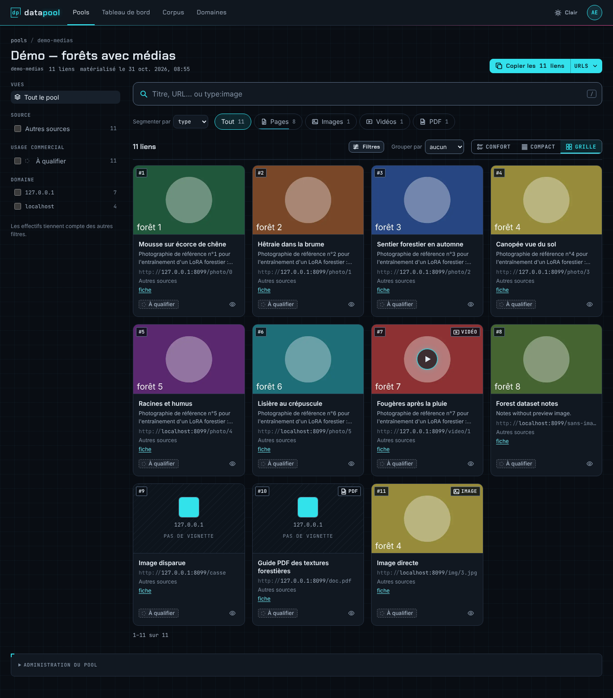
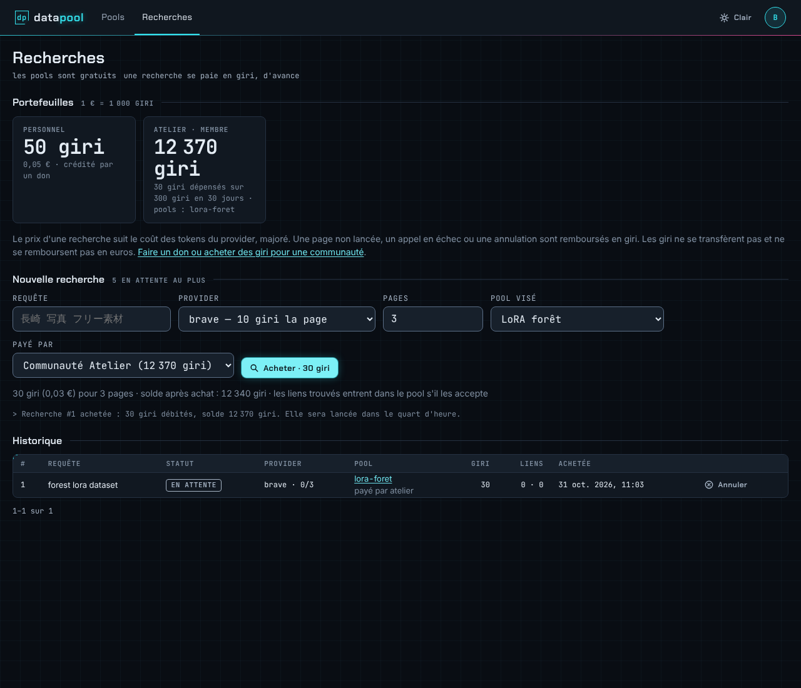

# datapool

Interface de visualisation de [webpool](https://github.com/RebelliousSmile/webpool) :
pools, corpus, domaines et activité du pipeline, lus par l'API HTTP de webpool
(`webpool serve`). Lecture, plus l'achat de recherches payantes.



## Écrans

| Écran | Accès | Contenu |
|---|---|---|
| Tableau de bord | admin | volumes du corpus, pools, domaines à qualifier, frontière d'exploration, derniers runs |
| Pools | admin, read | pools visibles ; détail en **outil de recherche** : barre de requête à jetons (`type:image usage:libre`, `/` pour y aller), facettes comptées (type de média, source, usage, domaine), onglets de segments, « Grouper par » avec « Copier ce groupe », trois densités (confort, compact, grille), aperçu d'un lien, vues enregistrées ; **copie ou téléchargement de la sélection** (URLs seules par défaut, Markdown, CSV). État dans l'URL (liens partageables). Chaque lien montre sa vignette et le favicon de son site (servis par le cache de webpool), sa description, son type de média et sa famille de source. Pour l'admin : fiche de chaque lien, synthèse, définition et export |
| Recherches | admin, read | soldes en giri (portefeuille personnel crédité par un don ; pot de chaque communauté avec rôle, plafond, dépense sur 30 jours et vos apports) ; **invitations** reçues (accepter, décliner) et **départ** d'une communauté (« Quitter », avec confirmation) ; achat d'une recherche (requête, provider, pages, pool visé ; un pool de communauté se paie sur son pot, jamais en personnel) avec son prix et le solde après achat ; **mouvements** repliables (grand livre personnel, ou du pot pour un propriétaire) ; historique filtrable par statut (giri dépensés après remboursement, liens trouvés, nouveaux et entrés dans le pool), annulation d'une recherche en attente ; le propriétaire d'une communauté — le membre qui a versé le plus de giri au pot, rôle calculé et non attribuable — voit ses recherches et gère ses membres (invitation, plafond, retrait d'un membre ; « invité » tant que l'invitation n'est pas acceptée ; « fondateur » pour le membre désigné par l'admin, propriétaire tant que personne n'a versé), l'admin voit toutes les recherches. Accessible depuis un pool par « ajouter une recherche à ce pool » |
| Corpus | admin | URLs filtrées (texte, statut, thème, domaine), triées par date, qualité ou pertinence ; copie ou téléchargement de la sélection (5 000 liens au plus, plafond annoncé) |
| Fiche URL | admin | sources (requête, provider, rang), thèmes, facettes, pools |
| Domaines | admin | registre, filtré par usage commercial (dont « à qualifier ») |

**Achat sûr.** Un achat à la fois (le bouton passe à « Achat… »). Chaque achat
part avec un en-tête `Idempotency-Key` : si la connexion tombe ou si l'API ne
répond pas dans les 15 s, relancer le même achat renvoie la même clé, et webpool
rend la recherche déjà achetée sans débiter une seconde fois (« déjà achetée,
rien de plus débité »). Une annulation en cours désactive son bouton. Après un
refus pour solde (402) ou file pleine (429), les soldes sont relus ; si leur
relecture échoue après un achat, l'achat reste affiché et l'erreur apparaît en
alerte au-dessus des soldes. Sur mobile, « Annuler » passe sous la requête.

Un client `read` (un client de webpool à qui l'on a accordé des pools, ou membre
d'une communauté) ne voit que ses pools et les pools publics (marqués « public »),
sans définition ni scores. Les pools
sont gratuits ; les recherches se paient en giri, voir
[webpool](https://github.com/RebelliousSmile/webpool#recherches-payantes--dons-et-giri).



## Direction artistique

« Data Pool » : terminal d'accès au Net, sombre par défaut (thème clair au choix,
mémorisé). Jetons, polices libres (Chakra Petch, JetBrains Mono, SIL OFL) et styles
viennent des maquettes v2 de la branche `design/data-pool` (`src/styles/`, commit
`8b63daa`, artefact « datapool — maquettes v2 ») ; la palette d'usage commercial est vérifiée pour les daltoniens et
chaque usage porte aussi une forme et un libellé.

## Démarrage

```bash
# côté webpool
pnpm webpool client add --name moi --scope admin     # note le jeton affiché
WEBPOOL_API_CORS_ORIGINS=http://localhost:5173 pnpm webpool serve

# côté datapool
pnpm install
pnpm dev            # http://localhost:5173 : saisir l'URL de l'API et le jeton
```

L'URL proposée par défaut vient de `VITE_WEBPOOL_API_URL` (voir `.env.example`).
L'URL et le jeton sont gardés dans le `localStorage` du navigateur ;
« Déconnexion » les efface, un jeton révoqué aussi, y compris en cours de
session : au premier 401, le formulaire de connexion revient avec un message.
Chaque appel à l'API abandonne après 15 s (« L'API ne répond pas »).

## Construction et hébergement

```bash
pnpm build          # site statique dans build/, repli index.html pour les routes
pnpm preview
```

`build/` se sert tel quel par n'importe quel serveur statique, à condition de
renvoyer `index.html` pour les chemins inconnus (application monopage). L'origine
de datapool doit figurer dans `WEBPOOL_API_CORS_ORIGINS` côté webpool.

Le jeton étant lisible par les scripts de la page, l'interface ne charge aucune
ressource tierce ; poser une `Content-Security-Policy` à l'hébergement.

## Déploiement (alwaysdata)

Même mécanique que webpool (`scripts/deploy.mjs`), pour un site statique.

**Préparation, une fois :**

- dans l'admin, *Web > Sites* : un site de type *Fichiers statiques* sur un
  sous-domaine, racine `www/datapool` ;
- côté webpool, l'origine du site dans `WEBPOOL_API_CORS_ORIGINS` de
  `~/www/webpool.env` (sans `/` final), puis redémarrage du site de l'API ;
- en local, la cible (fichier ignoré par git) ; la clé SSH de webpool convient :

```bash
cp deploy/targets.example.json deploy/targets.json   # host, user, sshKey, siteUrl, apiUrl…
```

**Déployer** depuis Windows (WSL avec Node, `rsync`, `ssh` et pnpm dans `~/.local/bin`) :

```bash
pnpm deploy:prod ad --check     # archive du commit + build en staging WSL, sans contacter la cible
pnpm deploy:prod ad             # prévisualisation : garde, CORS de webpool, fichiers modifiés
pnpm deploy:prod ad --apply     # livraison
```

Seul le commit `HEAD` de `main` part (`git archive`), jamais la copie de travail.
Le build fige `apiUrl` dans `VITE_WEBPOOL_API_URL` et le script génère le
`.htaccess` : repli de toutes les routes vers `index.html`, CSP (`connect-src` et
`img-src` limités à l'API, empreintes des scripts en ligne de `index.html`,
`style-src 'self'` sans `<style>` en ligne), HSTS (`max-age=31536000`),
`Permissions-Policy` (caméra, micro, géolocalisation, paiement refusés), cache
immuable pour `_app/immutable/`. L'application ne pose aucun `style=""` (les
`style:` de Svelte passent par le CSSOM, que la CSP laisse faire) ; seul
l'annonceur de navigation de SvelteKit en porte un, d'où `style-src-attr
'unsafe-inline'`. Avant toute mutation, il lit sur la cible
`WEBPOOL_API_CORS_ORIGINS` dans `~/www/webpool.env` (seule cette clé en sort) et
refuse si l'origine du site n'y figure pas.

`--apply`, sous verrou (`~/deploy/datapool-ad/lock`) et garde de cycle de vie :
synchronise dans `~/www/datapool.new` (droits 755/644 vérifiés), bascule vers
`~/www/datapool`, puis vérifie que `/` et `/pools` répondent 200 avec la CSP
attendue. La version précédente reste dans `~/www/datapool.old` jusqu'au
déploiement suivant ; la commande de restauration est affichée en fin de run.

## Contrat d'API

Les types TypeScript de l'API sont générés depuis `webpool/openapi.json`, attendu
dans un dossier voisin :

```bash
pnpm api:types      # → src/lib/api/schema.d.ts (versionné, ne pas éditer)
```

## Développement

```bash
pnpm lint           # ESLint (TypeScript, Svelte)
pnpm check          # svelte-check (types)
pnpm test           # vitest : client d'API, session, mise en forme, composants (jsdom)
pnpm test:coverage  # idem avec couverture de src/lib et planchers (rapport dans coverage/)
```

Les tests simulent `$app/paths`, `$app/navigation` et `$app/state` (`test/mocks/`) :
l'explorateur complet est testé dans jsdom.

La CI (`.github/workflows/ci.yml`, Node 22 et 24) enchaîne lint, check,
couverture et build. Les pages (`src/routes`) dépendent du routeur SvelteKit :
elles ne sont pas couvertes par vitest, seulement par `pnpm check`. Leur logique
vit donc dans `src/lib` et y est testée : état de l'écran Recherches
(`purchase.svelte.ts`), fonctions pures (`billing.ts`), composant `Async`.

Les liens vers les sites du corpus passent par `ExternalLink`, qui ne rend
cliquables que les URLs http(s) : une URL brute `javascript:` ne doit jamais
s'exécuter dans la page qui porte le jeton. Les liens internes passent par
`resolve()` de `$app/paths`.

`pnpm.overrides` force `minimatch` ≥ 11.0.1 (avis GHSA-g3hv-75wg-m249) dans les
outils de développement.

SvelteKit 3, Svelte 5, Vite 8. Alias `#lib/*` déclaré dans `imports` de
`package.json`.

| Chemin | Rôle |
|---|---|
| `src/lib/api/client.ts` | Client de l'API (jeton, erreurs, URLs) |
| `src/lib/api/schema.d.ts` | Types générés depuis `openapi.json` |
| `src/lib/session.svelte.ts` | Connexion : URL, jeton, client courant |
| `src/lib/format.ts` | Nombres, dates, usage commercial (ordre, forme, couleur), pagination, découpe d'URL |
| `src/lib/billing.ts` | Recherches payantes (fonctions pures) : giri et euros, payeurs possibles pour un pool, devis avant achat, statuts, requête de l'historique, grand livre |
| `src/lib/purchase.svelte.ts` | État de l'écran Recherches : chargement (pools une fois, réponses en retard ignorées), achat (garde, clé d'idempotence), annulation, invitations et départ |
| `src/lib/copy.ts` | Copie d'une liste : chargement de toutes les pages, formats, presse-papiers |
| `src/lib/explore.ts` | Explorateur (fonctions pures) : filtres, effectifs par facette, jetons, suggestions, groupes, état ↔ URL |
| `src/lib/kinds.ts` | Type de média et famille de source déduits localement : repli quand l'API ne les donne pas (API antérieure à la phase 3) |
| `src/lib/views.ts` | Vues enregistrées par pool (navigateur) |
| `src/lib/theme.svelte.ts` | Thème clair / sombre mémorisé |
| `src/styles/` | Jetons, styles et polices de la direction artistique |
| `src/lib/components/` | `Async` (chargement, erreur, contenu ; garde le contenu précédent pendant un rechargement), explorateur de pool (`PoolExplorer`, `QueryBar`, `SegmentTabs`, `FacetPanel`, `ResultItem`, `LinkPreview`), copie, menu de compte, connexion, badge d'usage, graphiques, pagination, pictogrammes, lien externe filtré |
| `src/routes/` | Écrans |

## Licence

[MIT](LICENSE).
