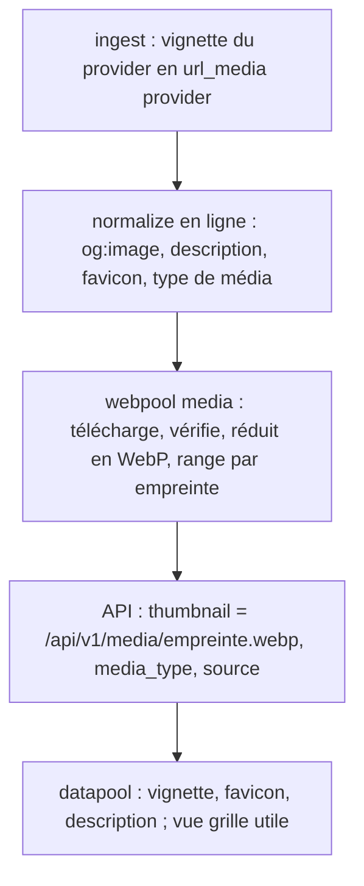

<!-- Fill or omit these sections; never add, rename, or reorder one. -->

# Instruction: Médias des liens dans webpool

Révisé le 2026-10-31, au démarrage de la phase : `main` de webpool a publié les
migrations 006 et 007 (tuyaux), et la v2 de datapool attend aussi le type de
média et la famille de source de chaque lien.

## Architecture projection

> Tree of the final files. ✅ create · ✏️ modify · ❌ delete

```txt
webpool
├── db/migrations/
│   └── 008_url_media.sql             ✅ url_item : description, media_type, lang, site_name ; table url_media (url_item_id, kind = og|provider, source_url, status = pending|cached|failed, file, width, height, bytes, error, fetched_at) ; domain_profile : favicon_source, favicon_status, favicon_file, favicon_error ; processing_run kind 'media'
├── package.json                      ✏️ dépendance sharp
├── .gitignore                        ✏️ var/ (cache local par défaut)
├── src/
│   ├── media/kinds.js                ✅ mediaOf(url, { contentType, ogType }) et sourceOf(domain) — fonctions pures, reprises de datapool/src/lib/kinds.ts
│   ├── normalize/normalizer.js       ✏️ extractMeta(html, baseUrl) : og:title, og:description / description, og:image, twitter:image, og:type, og:site_name, icônes, html lang (fonction pure)
│   ├── normalize/fetcher.js          ✏️ renvoie aussi le Content-Type ; lecture du corps injectable (pages ou octets d'image)
│   ├── normalize/index.js            ✏️ écrit métadonnées et media_type ; url_media `og` (ou l'URL elle-même si c'est une image) ; favicon du domaine ; un doublon cède ses médias à l'URL survivante
│   ├── ingest/providers/{flickr,europeana,brave}.js  ✏️ vignette fournie par le provider (Flickr `url_w`, Europeana `edmPreview`, Brave `thumbnail.src`)
│   ├── ingest/index.js               ✏️ url_media `provider` (repli quand la page n'a pas d'image)
│   ├── media/thumbnail.js            ✅ sharp : formats raster seulement (SVG refusé), 40 Mpx au plus, vignette 480 px de large, favicon 64 px, WebP sans métadonnées ; ICO : entrée PNG extraite
│   ├── media/index.js                ✅ cacheMedia({ limit, retryFailed }) : vignettes et favicons en attente, run `media`, fichiers nommés par empreinte (sha256) dans WEBPOOL_MEDIA_DIR
│   ├── cycle/index.js                ✏️ étape media après classify
│   ├── api/                          ✏️ champs description, media_type, source, thumbnail, favicon ; GET /api/v1/media/{fichier} (public, cache immuable) ; stats des médias
│   └── config.js                     ✏️ WEBPOOL_MEDIA_DIR, WEBPOOL_MEDIA_MAX_BYTES, WEBPOOL_MEDIA_CONCURRENCY
├── bin/webpool.js                    ✏️ webpool media [--limit N] [--retry-failed]
├── openapi.json                      ✏️
└── test/                             ✏️ extractMeta, kinds, thumbnail ; intégration : normalize → url_media → media (serveur HTTP local) → API

datapool
├── src/lib/api/schema.d.ts           ✏️ régénéré
├── src/lib/explore.ts, kinds.ts      ✏️ type et source de l'API ; la déduction locale devient un repli (anciens liens)
└── src/lib/components/               ✏️ MediaThumb, ResultItem, LinkPreview : vignette et favicon servis par l'API, description, repli si l'image échoue
```

## User Journey



## Decisions

| Decision | Why |
| -------- | --- |
| Vignette = og:image de la page (ou la page elle-même si c'est une image), sinon vignette du provider, sinon aucune (le favicon du domaine prend le relais). | La page connaît son meilleur aperçu ; Flickr et Europeana fournissent déjà une vignette fiable. |
| Téléchargement séparé de normalize (`webpool media`), étape de `cycle` après classify. | Normalize reste rapide ; les images se rattrapent par lots ; un échec d'image n'affecte pas l'URL. |
| Mêmes protections que normalize (garde d'hôte anti-SSRF, délai par hôte, retries, corps borné) + limite de pixels, formats raster seulement. | Une image est un contenu non fiable : bombes de décompression, SVG scriptés, hôtes internes. |
| Fichiers nommés par l'empreinte du WebP produit, servis par une route publique qui ne lit que le cache (`Cache-Control: immutable`). | Une balise `` ne peut pas envoyer le jeton ; la route ne télécharge jamais rien (pas de proxy ouvert) ; déduplication gratuite. |
| `media_type` stocké à la normalisation (Content-Type, og:type, URL) ; famille de source calculée à la lecture depuis le domaine. | Le type dépend de la réponse HTTP, vue une seule fois. La famille dépend d'une liste de domaines qui évoluera : la calculer à la lecture évite une reprise du corpus à chaque ajout. Une colonne de surcharge par domaine pourra venir si besoin. |
| `WEBPOOL_MEDIA_DIR` hors du dossier remplacé au déploiement (`~/www/webpool-data/media` sur alwaysdata). | Le swap de `deploy:code` ne doit pas effacer le cache. |
| Favicon par domaine (64 px), une seule source : apple-touch-icon, puis icône PNG, puis `.ico`, puis `/favicon.ico`. | Un seul téléchargement par site ; les PNG se réduisent proprement, les `.ico` modernes contiennent un PNG. |
| `sharp` (binaires précompilés linux-x64) comme seule nouvelle dépendance. | Le staging de déploiement installe en Linux natif (`pnpm install --prod`), alwaysdata est linux-x64 glibc. |

## Acceptance

- Une page avec `og:image` relative obtient une vignette WebP ≤ 480 px servie par l'API ; une page sans image affiche le favicon de son domaine.
- Une image > `WEBPOOL_MEDIA_MAX_BYTES`, un SVG, un hôte privé ou une image de plus de 40 Mpx sont refusés et tracés (`failed`, `error`), sans arrêter le lot.
- `GET /api/v1/media/<inconnu>` répond 404 ; aucun chemin hors du cache n'est lisible (`..`, encodages).
- `cycle` enchaîne media après classify ; un échec de media n'empêche pas le refresh des pools.
- datapool affiche vignettes, favicons et descriptions, et prend le type et la source de l'API ; la vue grille montre les images.
