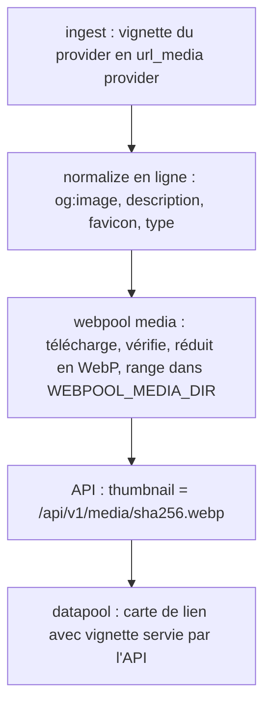

<!-- Fill or omit these sections; never add, rename, or reorder one. -->

# Instruction: Médias des liens dans webpool

## Architecture projection

> Tree of the final files (dépôt webpool). ✅ create · ✏️ modify · ❌ delete

```txt
.
├── db/migrations/
│   └── 006_url_media.sql             ✅ url_item : description, media_type, site_name, lang ; table url_media (url_item_id, kind = og|provider, source_url, status = pending|cached|failed|skipped, file, width, height, bytes, error, fetched_at) ; domain_profile : favicon_source, favicon_file
├── package.json                      ✏️ dépendance sharp (réduction et réencodage des images)
├── src/
│   ├── normalize/normalizer.js       ✏️ extractMeta(html, baseUrl) : og:title, og:description, og:image, og:type, twitter:image, link rel=icon, html lang, og:site_name (fonction pure)
│   ├── normalize/index.js            ✏️ écrit les métadonnées ; media_type depuis Content-Type et og:type ; enregistre l'image source (url_media pending) et le favicon du domaine
│   ├── ingest/providers/{flickr,europeana,brave}.js  ✏️ renvoient la vignette fournie par le provider (thumbnail)
│   ├── ingest/index.js               ✏️ url_media kind=provider (repli quand la page n'a pas d'og:image)
│   ├── media/fetch.js                ✅ téléchargement poli d'une image : garde d'hôte (hostGuard), délai par hôte, taille max, Content-Type image/*, timeout
│   ├── media/thumbnail.js            ✅ sharp : limite de pixels en entrée, redimensionnement 480 px (vignette) / 64 px (favicon), WebP, métadonnées EXIF retirées ; nom de fichier = sha256 du contenu produit
│   ├── media/index.js                ✅ cacheMedia({ limit }) : traite les url_media pending et les favicons manquants, trace un processing_run kind=media
│   ├── cycle/index.js                ✏️ étape media après classify
│   ├── api/handlers.js               ✏️ champs description, media_type, thumbnail, favicon dans PoolItem, UrlSummary, Url ; route GET /api/v1/media/{fichier}
│   ├── config.js                     ✏️ WEBPOOL_MEDIA_DIR, WEBPOOL_MEDIA_MAX_BYTES, WEBPOOL_MEDIA_CONCURRENCY
│   └── api/index.js                  ✏️ route publique /api/v1/media/:file
├── bin/webpool.js                    ✏️ webpool media [--limit N] [--retry-failed] ; normalize --refresh-media
├── openapi.json                      ✏️ nouveaux champs et route media
└── test/
    ├── normalizer.test.js            ✏️ extractMeta (relatives, protocoles refusés, longueurs bornées)
    ├── media.test.js                 ✅ thumbnail (image valide, image géante refusée, SVG refusé, non-image refusée)
    └── integration/media.test.js     ✅ normalize → url_media → cacheMedia (serveur HTTP local) → API renvoie l'URL de vignette et sert le fichier
```

## User Journey



## Decisions

| Decision | Why |
| -------- | --- |
| Vignette = og:image de la page, sinon vignette du provider, sinon aucune (le favicon du domaine prend le relais). | La page connaît son meilleur aperçu ; les providers images (Flickr, Europeana) fournissent déjà une vignette fiable. |
| Téléchargement séparé de normalize (`webpool media`), étape de `cycle`. | Normalize reste rapide et sa politesse réseau inchangée ; les images se rattrapent par lots, et un échec d'image n'affecte pas l'URL. |
| Mêmes protections que normalize (garde d'hôte anti-SSRF, délai par hôte, taille bornée, retries) + limite de pixels et refus du SVG. | Une image est un contenu non fiable : bombes de décompression, SVG scriptés, hôtes internes. |
| Fichiers nommés par l'empreinte du WebP produit, servis par une route publique qui ne lit que le cache. | Une balise `` ne peut pas envoyer le jeton ; la route ne télécharge jamais rien (pas de proxy ouvert) et ne révèle aucune donnée non publique. Déduplication gratuite. |
| `WEBPOOL_MEDIA_DIR` hors du dossier remplacé au déploiement (`~/www/webpool-data/media`). | Le swap de `deploy:code` ne doit pas effacer le cache. |
| Favicon par domaine (64 px), pas par URL. | Un seul téléchargement par site. |

## Acceptance

- Une page avec `og:image` relative obtient une vignette WebP ≤ 480 px servie par l'API ; une page sans image affiche le favicon de son domaine.
- Une image > `WEBPOOL_MEDIA_MAX_BYTES`, un SVG, un hôte privé ou une image de plus de 40 Mpx sont refusés et tracés (`failed`, `error`), sans arrêter le lot.
- `GET /api/v1/media/<inconnu>` répond 404 ; aucun chemin hors du cache n'est lisible (`..`, encodages).
- `cycle` enchaîne media après classify ; un échec de media n'empêche pas le refresh des pools.
