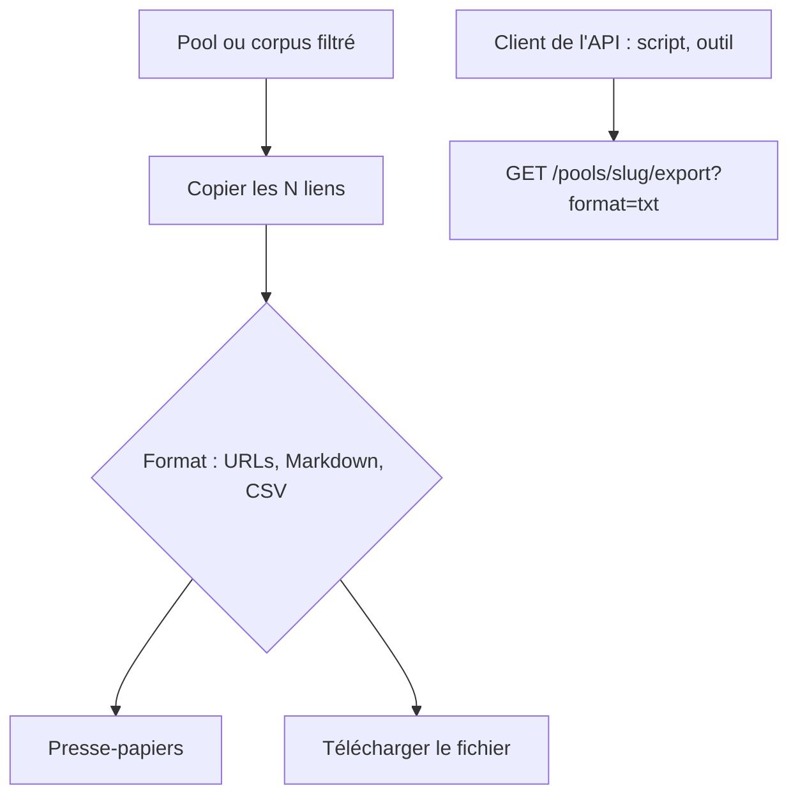

<!-- Fill or omit these sections; never add, rename, or reorder one. -->

# Instruction: Représentation des liens et copie de liste

Révisé le 2026-10-31. Déjà livré par les phases 3 et 5 : carte de lien (vignette,
favicon agrandi ou pictogramme, titre ou URL, description, usage, rang, URL
sélectionnable), densités confort / compact / grille mémorisées, aucune `iframe`,
copie du pool entier ou de la sélection filtrée (URLs seules par défaut, Markdown,
CSV) avec confirmation et repli par téléchargement. Restent l'export de l'API pour
les clients `read` et la copie du corpus filtré.

## Architecture projection

> ✅ create · ✏️ modify · ❌ delete

```txt
webpool
├── src/pools/export.js               ✏️ format txt (une URL par ligne) ; variante client sans définition ni score (json, csv, md, txt)
├── src/api/handlers.js               ✏️ export des pools visibles par le client (variante client) ; usage commercial dans le corpus (/admin/urls)
├── src/api/index.js                  ✏️ GET /api/v1/pools/:slug/export (read) ; l'export admin (/admin/pools/:slug/export) garde définition et scores, gagne txt
├── openapi.json                      ✏️
└── test/{export,api}.test.js, test/integration/api.test.js  ✏️

datapool
├── src/lib/components/CopyLinks.svelte   ✏️ « Télécharger le fichier » dans le menu : la sélection au format choisi ; libellé de plafond
├── src/routes/corpus/+page.svelte        ✏️ « Copier les N liens » de la sélection filtrée (admin), toutes pages, plafonnée à 5 000 et annoncée
├── src/lib/copy.ts                       ✏️ fetchAllUrls (pages de 500, plafond) ; extension de fichier par format
├── src/lib/api/schema.d.ts               ✏️ régénéré
└── test/                                 ✏️
```

## User Journey



## Decisions

| Decision | Why |
| -------- | --- |
| Dans datapool, copie et téléchargement partent de la sélection en mémoire, pas de l'export de l'API. | Depuis la v2, filtres, segments et groupes se calculent dans le navigateur : seul lui connaît la sélection. Le pool entier y est déjà chargé. |
| L'export de l'API est ouvert aux clients `read` sur leurs pools, sans définition ni score, avec le format `txt`. | Les clients qui appellent l'API directement (scripts, outils) obtiennent la liste en un appel, dans l'ordre de rang. Même règle que les items : les critères restent internes. |
| Copie du corpus filtré (admin) plafonnée à 5 000 liens, plafond annoncé. | Le corpus n'est pas borné comme un pool ; dix appels de 500 au plus. |
| Format par défaut : URLs seules. | Choix de l'utilisateur, 2026-10-30. |

## Acceptance

- Un client `read` obtient `GET /pools/{slug}/export?format=txt` : une URL par ligne, dans l'ordre de rang ; 404 sur un pool non accordé ; ni définition ni score dans aucun format.
- Depuis le menu de copie, « Télécharger le fichier » enregistre la sélection courante au format choisi.
- Sur le corpus filtré, « Copier les N liens » copie toutes les pages (plafond de 5 000 annoncé).
- Le presse-papiers refusé produit un message et un lien de téléchargement, pas un échec silencieux.
