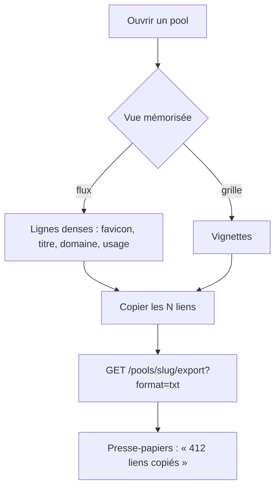

<!-- Fill or omit these sections; never add, rename, or reorder one. -->

# Instruction: Représentation des liens et copie de liste

## Architecture projection

> ✅ create · ✏️ modify · ❌ delete

```txt
webpool
├── src/pools/export.js               ✏️ format txt (une URL par ligne) ; variante client sans définition ni score (json, csv, md)
├── src/api/handlers.js               ✏️ export accessible aux clients read sur leurs pools (variante client), formats txt|md|csv|json
├── src/api/index.js                  ✏️ GET /api/v1/pools/:slug/export (read) ; l'export admin reste à /admin/pools/:slug/export
├── openapi.json                      ✏️
└── test/{export,api}.test.js, test/integration/api.test.js  ✏️

datapool
├── src/lib/api/client.ts             ✏️ exportPool(slug, format) côté read, médias dans les types
├── src/lib/copy.ts                   ✅ copyText (navigator.clipboard, repli textarea), formatage d'une sélection
├── src/lib/components/LinkCard.svelte    ✅ vignette | favicon | pictogramme, titre (ou URL), domaine, description, badge usage, rang, URL sélectionnable
├── src/lib/components/LinkRow.svelte     ✅ ligne dense (vue flux)
├── src/lib/components/CopyLinks.svelte   ✅ bouton « Copier les N liens », menu de format (URLs par défaut, Markdown, CSV), confirmation et erreur
├── src/lib/components/ViewToggle.svelte  ✅ flux | grille, mémorisé par pool (localStorage)
├── src/routes/pools/[slug]/+page.svelte  ✏️ vues flux / grille, CopyLinks
├── src/routes/corpus/+page.svelte        ✏️ copie de la sélection filtrée (admin, toutes pages, plafonnée et annoncée)
└── test/copy.test.ts                 ✅
```

## User Journey



## Decisions

| Decision | Why |
| -------- | --- |
| La copie passe par l'export de l'API, pas par les pages chargées. | « Toute la liste » = tout le pool, même 1 000 liens, en un appel, dans l'ordre de rang. |
| Format par défaut : URLs seules ; Markdown et CSV proposés. | Choix de l'utilisateur, 2026-10-30. |
| Export client sans définition ni score. | Même règle que les items : les critères restent internes. |
| Copie du corpus filtré plafonnée (5 000 liens, annoncé). | Le corpus n'est pas borné comme un pool. |

## Acceptance

- Un client read copie les 412 liens d'un pool de 412 en un clic, une URL par ligne, dans l'ordre de rang ; l'API lui refuse les pools non accordés (404).
- La vue choisie est retrouvée en revenant sur le pool.
- Une carte reste lisible sans image, sans titre, avec un titre de 300 caractères.
- Le presse-papiers refusé (contexte non sécurisé, permission) produit un message, pas un échec silencieux.
