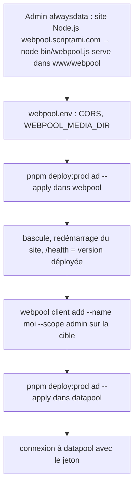

<!-- Fill or omit these sections; never add, rename, or reorder one. -->

# Instruction: Mise en production alwaysdata

Le déploiement de datapool (site statique, `pnpm deploy:prod`) est fait (`main`
412fa95). Reste l'API de webpool : un site Node.js qui lance `webpool serve`,
redémarré après chaque bascule, et le cache de médias de la phase 3.

Le déploiement lui-même se lance depuis le poste de l'utilisateur (WSL, clé SSH
dédiée) : cette phase prépare scripts, contrat et procédure, et ne contacte pas
la cible.

## Architecture projection

> ✅ create · ✏️ modify · ❌ delete

```txt
webpool
├── scripts/deploy-lib.mjs        ✏️ cible : apiUrl, apiSiteId (optionnels), mediaDir (défaut www/webpool-data/media) ; ENV_KEYS_CHECK (seules WEBPOOL_MEDIA_DIR et WEBPOOL_API_CORS_ORIGINS sortent du fichier env) ; restartRequest (requête de redémarrage, fonction pure) ; healthMatches
├── scripts/deploy.mjs            ✏️ crée le dossier du cache ; refuse si WEBPOOL_MEDIA_DIR n'y pointe pas ; après la bascule : redémarre le site de l'API (API alwaysdata si ALWAYSDATA_API_TOKEN est défini en local, sinon consigne manuelle), puis attend /api/v1/health avec la version déployée
├── src/api/handlers.js           ✏️ /health renvoie aussi la version de webpool
├── deploy/contract.json          ✏️ opération deploy:api ; secretNames : WEBPOOL_API_CORS_ORIGINS, WEBPOOL_MEDIA_DIR ; jeton alwaysdata local, jamais transféré
├── deploy/targets.example.json   ✏️ apiUrl, apiSiteId, mediaDir
├── openapi.json                  ✏️ Health : version
├── README.md                     ✏️ procédure de mise en production de l'API
└── test/deploy-lib.test.js       ✏️

datapool
└── aidd_docs/…/phase-6.md        ✅ ce plan, puis la procédure suivie
```

## User Journey



## Decisions

| Decision | Why |
| -------- | --- |
| L'API est un site *Node.js* alwaysdata dont la commande est `node $HOME/www/webpool/bin/webpool.js serve` ; il écoute sur `IP` et `PORT` fournis par alwaysdata, que la configuration lit déjà. | Aucun processus à superviser soi-même ; `.env` est déjà un lien vers `~/www/webpool.env`. |
| Le site est redémarré après chaque bascule. | La bascule renomme `~/www/webpool` en `.old` : sans redémarrage, le processus continue de servir l'ancien code depuis `.old`, purgé au déploiement suivant. |
| Redémarrage par l'API alwaysdata (`POST /v1/site/{apiSiteId}/restart/`) seulement si `ALWAYSDATA_API_TOKEN` est défini dans le shell local ; sinon le script s'arrête sur la consigne « redémarrer le site dans l'admin » et attend la bonne version. | Le jeton donne la main sur tout le compte : il n'est ni versionné, ni copié sur la cible. La requête est à confirmer au premier essai (documentation alwaysdata non consultable depuis la session de préparation). |
| `/health` renvoie la version de webpool ; le déploiement attend cette version après redémarrage. | Prouve que le nouveau code sert, pas seulement qu'un serveur répond. |
| Le script refuse de livrer si `WEBPOOL_MEDIA_DIR` du fichier env ne pointe pas sur le dossier de cache de la cible ; il crée ce dossier. | Sans lui, le cache irait dans `var/media` du code, effacé par la bascule suivante. Seules les clés nommées sortent du fichier env, comme pour la vérification CORS de datapool. |
| Ordre de mise en production : webpool (migrations jusqu'à 012, API) avant datapool. | datapool vérifie le CORS de webpool et a besoin de l'API pour se connecter. |

## Procédure

Préparée et testée hors cible (webpool `0b82fc4`, 318 tests ; datapool `main`
412fa95 pour son propre déploiement). Mise à jour le 2026-11-03 : datapool `main`
(`1cafd6b`, écran Recherches) appelle `/billing`, `/requests` et
`/communities/{slug}/…`, livrés par webpool#19 (recherches payantes, communautés,
correctifs de l'audit du 2026-10-31), fusionnée dans webpool `main` en `32ffc95`
(CI verte). C'est ce commit, ou un suivant, qui part. À dérouler depuis le poste
(seul `main` se déploie) :

1. **Admin alwaysdata, site de l'API** (*Web > Sites > Ajouter*) : type Node.js,
   adresse `webpool.scriptami.com`, commande `node $HOME/www/webpool/bin/webpool.js serve`,
   répertoire de travail `www/webpool`, environnement `NODEJS_VERSION=24`.
2. **`~/www/webpool.env`** (sur la cible) : ajouter
   `WEBPOOL_MEDIA_DIR=/home/<compte>/www/webpool-data/media` (chemin absolu) et
   `WEBPOOL_API_CORS_ORIGINS=https://datapool.scriptami.com`. Les variables de
   tarification et de file des recherches (`WEBPOOL_GIRI_PER_EUR`,
   `WEBPOOL_PRICE_MARKUP`, `WEBPOOL_REQUEST_*`, `WEBPOOL_MIN_CREDIT_CENTS`,
   `WEBPOOL_FUNDING_URL`… voir `.env.example`) ont toutes un défaut dans
   `src/config.js` : n'en poser que pour s'en écarter (`WEBPOOL_FUNDING_URL` pour
   que l'interface affiche un lien de financement).
3. **`deploy/targets.json`** de webpool : le fichier existe déjà (constat du
   2026-11-03) mais sans `apiUrl` ni `apiSiteId` ; ajouter `apiUrl`
   (`https://webpool.scriptami.com/api/v1`) et `apiSiteId` (identifiant numérique du site
   de l'API) pour le redémarrage automatique. `mediaDir` peut rester absent : défaut
   `www/webpool-data/media`.
4. **webpool** : hors du passage de la tâche planifiée `cycle` (chaque jour à 4 h depuis le 2026-11-03, le lundi avant) — elle
   tourne dans `www/webpool`, que la bascule remplace. `pnpm deploy:prod ad`
   (prévisualisation), puis
   `ALWAYSDATA_API_TOKEN=$ALWAYSDATA_API_KEY pnpm deploy:prod ad --apply` : webpool
   lit `ALWAYSDATA_API_TOKEN` dans le shell seulement, pas dans `.env`, alors que la
   clé des autres projets s'appelle `ALWAYSDATA_API_KEY`. Sans elle, redémarrer le
   site dans l'admin quand le script le demande. Attendu : migrations jusqu'à
   `012` (la cible était à `007` : `008_url_media` à `012_community_ownership`),
   « API à jour ».
5. **Sur la cible** : `cd ~/www/webpool && NODEJS_VERSION=24 node bin/webpool.js client add --name <nom> --scope admin`,
   puis `node bin/webpool.js media` pour remplir le cache. Puis, dans l'admin
   (*Avancé > Tâches planifiées*), créer la tâche des recherches payantes :
   commande `node bin/webpool.js requests run`, répertoire `www/webpool`,
   environnement `NODEJS_VERSION=24`, fréquence `*/15 * * * *`. La créer après le
   premier déploiement évite qu'elle tourne dans un répertoire sans migrations.
   Aux déploiements suivants, un passage tous les quarts d'heure rend le créneau
   impossible à éviter : une recherche interrompue par la bascule reste `running`,
   puis le `requests run` suivant la clôt et la rembourse au bout d'une heure
   (`deploy/contract.json` de webpool).
6. **datapool** : *Web > Sites*, site *Fichiers statiques* `datapool.scriptami.com`,
   racine `www/datapool` ; `deploy/targets.json` (`siteUrl` = `https://datapool.scriptami.com`, `apiUrl` = `https://webpool.scriptami.com/api/v1`) ;
   `pnpm deploy:prod ad --apply`.
7. **Contrôle** : `https://webpool.scriptami.com/api/v1/health` (version et commit),
   connexion à `https://datapool.scriptami.com` avec le jeton, un pool avec vignettes.

Retour arrière : code (`~/www/webpool.old`, commande affichée par le script) puis
redémarrage du site ; schéma (`pg_restore` de la sauvegarde affichée). Pour
datapool, `~/www/datapool.old`.

La requête de redémarrage (`POST https://api.alwaysdata.com/v1/site/<id>/restart/`,
identifiant « <jeton> account=<compte> », mot de passe vide) est celle que
lyremember et personal-site emploient déjà en production
(`scripts/deploy.mjs` de chacun) : même URL, même identifiant Basic. Reste propre à
webpool le compte, tiré de `user` dans la cible. En cas de refus, le script le
signale et le redémarrage manuel reste possible.

Déroulé du 2026-11-03. webpool `32ffc95` : sauvegarde
`~/deploy/webpool-ad/backups/webpool-20261103T131914Z-32ffc95.dump`, migrations
`008` à `012`, bascule. Lancé sans `ALWAYSDATA_API_TOKEN` : l'attente de 3 min
s'est écoulée avant le redémarrage manuel, d'où le code de sortie 1. La ligne
« Redémarrer maintenant » n'arrive dans un journal redirigé qu'à la fin du
script : à surveiller dans le terminal, pas dans un fichier. Après le redémarrage,
`/health` renvoie `0.1.0` et `32ffc95`, et le CORS accepte
`https://datapool.scriptami.com`. `webpool media` : 0 sur 0, parce que les liens déjà en
base ont été normalisés avant `008` et n'ont pas de ligne `url_media`. datapool
`3543bb3` : garde posée, HTTP 200, CSP présente, connexion avec le jeton vérifiée.
Depuis PowerShell, `wsl ssh -i '~/.ssh/webpool_ci' …` : sans apostrophes,
PowerShell remplace `~` par le profil Windows.

## Acceptance

- `pnpm deploy:prod ad` (prévisualisation) signale un `WEBPOOL_MEDIA_DIR` absent ou faux et l'absence d'`apiUrl`.
- `--apply` : migrations appliquées, bascule, redémarrage (API ou consigne), `/api/v1/health` répond `{ ok: true, version }` avec la version déployée.
- datapool déployé se connecte avec un jeton créé sur la cible ; un pool s'affiche.
- Les liens ingérés ou normalisés après la mise en production ont leur vignette et leur favicon (`url_media` alimentée à l'ingestion et à la normalisation, puis `webpool media`). Les liens normalisés avant la migration `008` n'en ont pas : leur reprise est hors de cette phase.
- Retour arrière documenté : code (`.old`), schéma (`pg_restore`), puis redémarrage du site.
