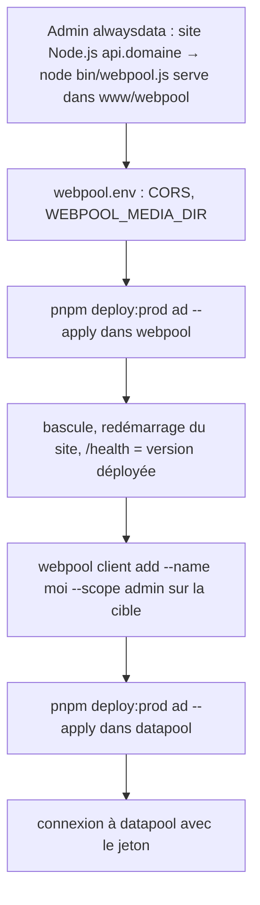

<!-- Fill or omit these sections; never add, rename, or reorder one. -->

# Instruction: Mise en production alwaysdata

Le déploiement de datapool (site statique, `pnpm deploy:prod`) est fait (`main`
412fa95). Reste l'API de webpool : un site Node.js qui lance `webpool serve`,
redémarré après chaque bascule, et le cache de médias de la phase 3.

Le déploiement lui-même se lance depuis le poste de l'utilisateur (WSL, clé SSH
dédiée) : cette phase prépare scripts, contrat et procédure, et ne contacte pas
la cible.

## Architecture projection

> ✅ create · ✏️ modify · ❌ delete

```txt
webpool
├── scripts/deploy-lib.mjs        ✏️ cible : apiUrl, apiSiteId (optionnels), mediaDir (défaut www/webpool-data/media) ; ENV_KEYS_CHECK (seules WEBPOOL_MEDIA_DIR et WEBPOOL_API_CORS_ORIGINS sortent du fichier env) ; restartRequest (requête de redémarrage, fonction pure) ; healthMatches
├── scripts/deploy.mjs            ✏️ crée le dossier du cache ; refuse si WEBPOOL_MEDIA_DIR n'y pointe pas ; après la bascule : redémarre le site de l'API (API alwaysdata si ALWAYSDATA_API_TOKEN est défini en local, sinon consigne manuelle), puis attend /api/v1/health avec la version déployée
├── src/api/handlers.js           ✏️ /health renvoie aussi la version de webpool
├── deploy/contract.json          ✏️ opération deploy:api ; secretNames : WEBPOOL_API_CORS_ORIGINS, WEBPOOL_MEDIA_DIR ; jeton alwaysdata local, jamais transféré
├── deploy/targets.example.json   ✏️ apiUrl, apiSiteId, mediaDir
├── openapi.json                  ✏️ Health : version
├── README.md                     ✏️ procédure de mise en production de l'API
└── test/deploy-lib.test.js       ✏️

datapool
└── aidd_docs/…/phase-6.md        ✅ ce plan, puis la procédure suivie
```

## User Journey



## Decisions

| Decision | Why |
| -------- | --- |
| L'API est un site *Node.js* alwaysdata dont la commande est `node $HOME/www/webpool/bin/webpool.js serve` ; il écoute sur `IP` et `PORT` fournis par alwaysdata, que la configuration lit déjà. | Aucun processus à superviser soi-même ; `.env` est déjà un lien vers `~/www/webpool.env`. |
| Le site est redémarré après chaque bascule. | La bascule renomme `~/www/webpool` en `.old` : sans redémarrage, le processus continue de servir l'ancien code depuis `.old`, purgé au déploiement suivant. |
| Redémarrage par l'API alwaysdata (`POST /v1/site/{apiSiteId}/restart/`) seulement si `ALWAYSDATA_API_TOKEN` est défini dans le shell local ; sinon le script s'arrête sur la consigne « redémarrer le site dans l'admin » et attend la bonne version. | Le jeton donne la main sur tout le compte : il n'est ni versionné, ni copié sur la cible. La requête est à confirmer au premier essai (documentation alwaysdata non consultable depuis la session de préparation). |
| `/health` renvoie la version de webpool ; le déploiement attend cette version après redémarrage. | Prouve que le nouveau code sert, pas seulement qu'un serveur répond. |
| Le script refuse de livrer si `WEBPOOL_MEDIA_DIR` du fichier env ne pointe pas sur le dossier de cache de la cible ; il crée ce dossier. | Sans lui, le cache irait dans `var/media` du code, effacé par la bascule suivante. Seules les clés nommées sortent du fichier env, comme pour la vérification CORS de datapool. |
| Ordre de mise en production : webpool (migrations 005 à 008, API) avant datapool. | datapool vérifie le CORS de webpool et a besoin de l'API pour se connecter. |

## Procédure

Préparée et testée hors cible (webpool `0b82fc4`, 318 tests ; datapool `main`
412fa95 pour son propre déploiement). À dérouler depuis le poste, une fois les
deux branches dans `main` (seul `main` se déploie) :

1. **Admin alwaysdata, site de l'API** (*Web > Sites > Ajouter*) : type Node.js,
   adresse `api.<domaine>`, commande `node $HOME/www/webpool/bin/webpool.js serve`,
   répertoire de travail `www/webpool`, environnement `NODEJS_VERSION=24`.
2. **`~/www/webpool.env`** (sur la cible) : ajouter
   `WEBPOOL_MEDIA_DIR=/home/<compte>/www/webpool-data/media` (chemin absolu) et
   `WEBPOOL_API_CORS_ORIGINS=https://datapool.<domaine>`.
3. **`deploy/targets.json`** de webpool : `apiUrl` (`https://api.<domaine>/api/v1`),
   et `apiSiteId` pour le redémarrage automatique (sinon retirer la clé).
4. **webpool** : `pnpm deploy:prod ad` (prévisualisation), puis
   `ALWAYSDATA_API_TOKEN=… pnpm deploy:prod ad --apply` (ou sans jeton : redémarrer
   le site dans l'admin quand le script le demande). Attendu : migrations jusqu'à
   `008`, « API à jour ».
5. **Sur la cible** : `cd ~/www/webpool && NODEJS_VERSION=24 node bin/webpool.js client add --name <nom> --scope admin`,
   puis `node bin/webpool.js media` pour remplir le cache.
6. **datapool** : *Web > Sites*, site *Fichiers statiques* `datapool.<domaine>`,
   racine `www/datapool` ; `deploy/targets.json` (`siteUrl`, `apiUrl`) ;
   `pnpm deploy:prod ad --apply`.
7. **Contrôle** : `https://api.<domaine>/api/v1/health` (version et commit),
   connexion à `https://datapool.<domaine>` avec le jeton, un pool avec vignettes.

Retour arrière : code (`~/www/webpool.old`, commande affichée par le script) puis
redémarrage du site ; schéma (`pg_restore` de la sauvegarde affichée). Pour
datapool, `~/www/datapool.old`.

La requête de redémarrage (`POST https://api.alwaysdata.com/v1/site/<id>/restart/`,
identifiant « <jeton> account=<compte> ») vient de la documentation d'alwaysdata
via une recherche : elle n'a pas pu être vérifiée depuis la session de préparation
(domaine help.alwaysdata.com non autorisé). En cas de refus, le script le signale
et le redémarrage manuel reste possible.

## Acceptance

- `pnpm deploy:prod ad` (prévisualisation) signale un `WEBPOOL_MEDIA_DIR` absent ou faux et l'absence d'`apiUrl`.
- `--apply` : migrations appliquées, bascule, redémarrage (API ou consigne), `/api/v1/health` répond `{ ok: true, version }` avec la version déployée.
- datapool déployé se connecte avec un jeton créé sur la cible ; un pool s'affiche avec ses vignettes.
- Retour arrière documenté : code (`.old`), schéma (`pg_restore`), puis redémarrage du site.
