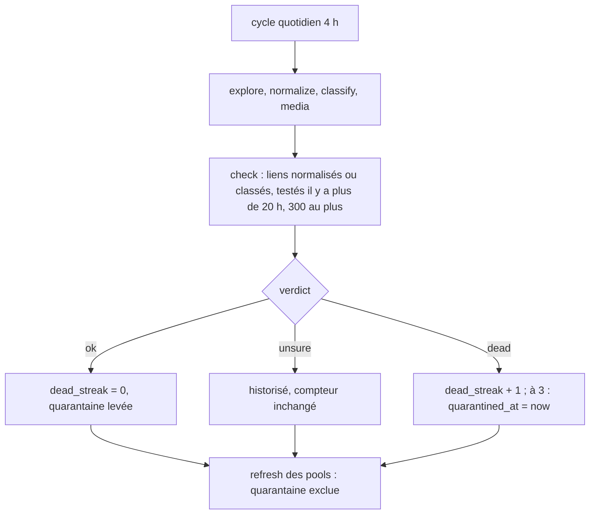
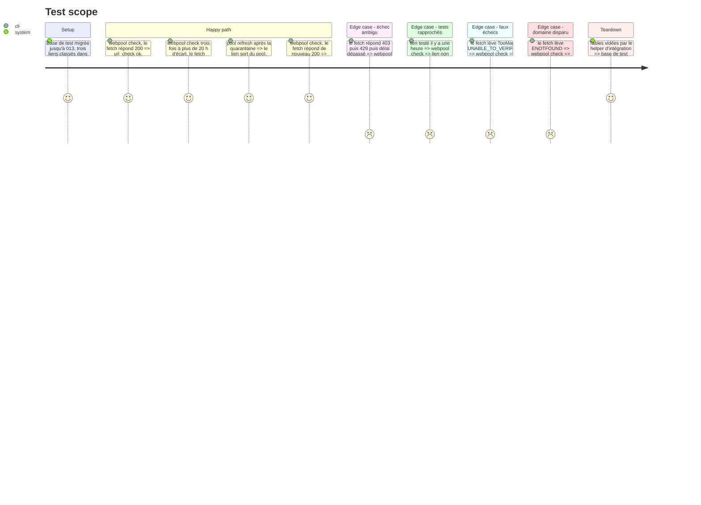

<!-- Fill or omit these sections; never add, rename, or reorder one. -->

# Instruction: webpool — contrôle des liens, historique et quarantaine

## Architecture projection

> Tree of the final files. ✅ create · ✏️ modify · ❌ delete

```txt
webpool
├── db/migrations/013_url_check.sql   ✅ table url_check (url_item_id ON DELETE CASCADE, checked_at, http_status, verdict ok|dead|unsure, error = étiquette rendue par verdictOf (HOST_REFUSED, TOO_MANY_REDIRECTS, sinon `code` comme ENOTFOUND, sinon `name` comme TimeoutError, sinon UNKNOWN), final_url, run_id) + index (url_item_id, checked_at DESC) ; url_item : checked_at, dead_streak (défaut 0), quarantined_at + index partiel des liens à tester ; processing_run_kind_check élargi à 'check' (DROP/ADD, comme 008 et 009)
├── src/check/verdict.js              ✅ fonctions pures : verdictOf({ httpStatus, error }) → { verdict: ok|dead|unsure, label } (l'erreur puis sa chaîne `cause` : ENOTFOUND, ECONNREFUSED, CERT_HAS_EXPIRED, ERR_TLS_CERT_ALTNAME_INVALID et HostRefusedError → dead ; le reste → unsure) ; nextState({ streak, quarantinedAt, verdict, now, threshold })
├── src/check/index.js                ✅ checkLinks({ limit, fetcher }) sous withRun('check') : sélection, fetch sans lecture du corps, url_check + url_item dans une transaction par lien, purge de la rétention
├── src/cycle/index.js                ✏️ étape `check` entre processPending et refreshPools (sautée hors ligne), pour que la quarantaine du jour sorte des pools au même passage
├── src/pools/criteria.js             ✏️ `ui.quarantined_at IS NULL` ajouté aux conditions `always`
├── src/config.js                     ✏️ checkLimit (300), checkIntervalHours (20), checkThreshold (3), checkRetentionDays (90)
├── bin/webpool.js                    ✏️ commande `check [--limit N]` ; aide
├── .env.example                      ✏️ WEBPOOL_CHECK_*
├── README.md                         ✏️ section « Contrôle des liens » (verdicts, quarantaine, réglages), étapes du cycle, migration 013 dans la table des fichiers
├── test/verdict.test.js              ✅ verdicts et compteur (fonctions pures)
└── test/integration/check.test.js    ✅ passe complète sur base de test, fetch injecté
```

## User Journey



## Test Scope



## Tasks to do

### `1)` Migration 013

> Le schéma porte l'historique et l'état de contrôle.

1. `url_check` et son index ; colonnes et index partiel sur `url_item` (`status IN ('normalized','classified')`, tri `checked_at NULLS FIRST`).
2. Élargir `processing_run_kind_check` à `check` en reprenant la liste de `009`.

### `2)` Verdict et compteur

> Règle de la quarantaine, testable sans réseau.

1. `verdictOf` : 2xx → ok ; 404, 410 → dead ; autre statut → unsure ; erreurs classées par `code` sur l'erreur puis sa chaîne `cause` (une erreur DNS de `assertPublicHost` arrive non enveloppée, une erreur de connexion sous « fetch failed ») ; `TooManyRedirectsError`, `TimeoutError` (`name`) et toute erreur inconnue → unsure. L'étiquette stockée dans `url_check.error` vient de `instanceof` pour `HostRefusedError` et `TooManyRedirectsError` (ni l'une ni l'autre ne pose `name`), puis de `code`, puis de `name`.
2. `nextState` : ok → streak 0, quarantaine levée ; unsure → inchangé ; dead → streak + 1, quarantaine posée à `threshold` (date d'origine gardée si déjà en quarantaine).

### `3)` Commande `check`

> Une passe bornée, sous `withRun('check')`.

1. Sélection : `normalized`/`classified`, `checked_at` NULL ou plus vieux que `checkIntervalHours`, ordre `checked_at NULLS FIRST, id`, `LIMIT`.
2. Fetcher partagé (`createFetcher({ retries: 0, read })`) avec un `read` qui annule le corps ; URL testée : `canonical_url`, sinon `raw_url` ; `mapLimit` à `config.concurrency`.
3. Par lien, une transaction : insert `url_check`, update `url_item` (checked_at, dead_streak, quarantined_at) ; `http_status` reste celui de la normalisation.
4. Purge `url_check` plus vieux que `checkRetentionDays`.
5. Résumé : testés, ok, dead, unsure, mis en quarantaine, sortis de quarantaine.

### `4)` Cycle, pools, CLI, docs

> La quarantaine prend effet dans le cycle quotidien.

1. Étape `check` dans `runCycle` avant `refreshPools`, sautée si `offline`.
2. `criteria.js` : condition `always` sur `quarantined_at IS NULL`.
3. `bin/webpool.js check [--limit N]` ; README, `.env.example`.

## Test acceptance criteria

| Task | Acceptance criteria |
| ---- | ------------------- |
| 1 | `pnpm webpool migrate` applique `013` sur une base à `012` ; un run `check` s'enregistre dans `processing_run`. |
| 2 | 403, 429, 503, délai dépassé, `EAI_AGAIN`, trop de redirections et chaîne de certificats incomplète donnent `unsure` ; 404, 410, `ENOTFOUND` (enveloppé ou non), `ECONNREFUSED`, `CERT_HAS_EXPIRED` et hôte refusé donnent `dead` ; trois `dead` consécutifs mettent en quarantaine, un `unsure` entre deux ne remet pas à zéro, un `ok` lève la quarantaine. |
| 3 | Un lien testé il y a moins de 20 h n'est pas retesté ; `--limit 5` teste 5 liens au plus ; chaque test laisse une ligne `url_check` ; les lignes de plus de 90 jours disparaissent. |
| 4 | Après `cycle`, un lien en quarantaine n'est plus dans aucun pool et garde `status = 'classified'` ; un `200` le remet dans ses pools au passage suivant ; `cycle --offline` ne teste rien. |
