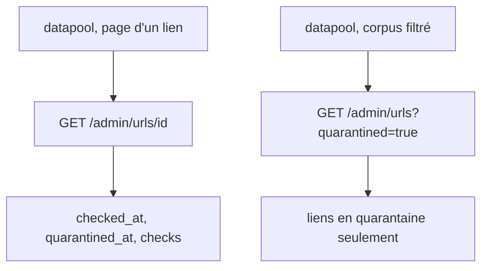
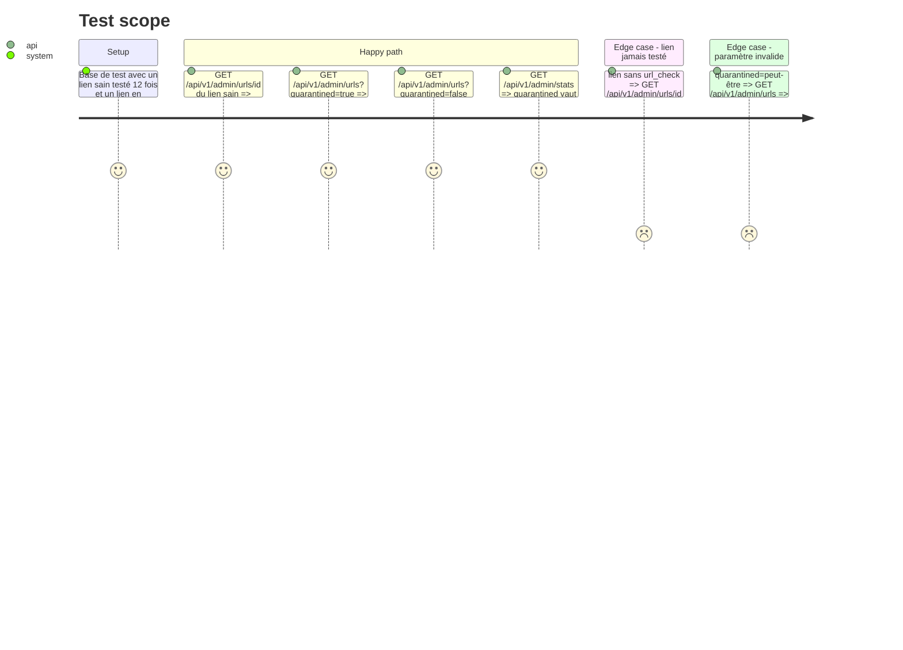

<!-- Fill or omit these sections; never add, rename, or reorder one. -->

# Instruction: webpool — API du contrôle des liens

## Architecture projection

> Tree of the final files. ✅ create · ✏️ modify · ❌ delete

```txt
webpool
├── src/api/handlers.js            ✏️ getUrl : checked_at, quarantined_at, dead_streak, checks (10 derniers : checked_at, http_status, verdict, error) ; listUrls : champs checked_at et quarantined_at, paramètre booléen `quarantined` (boolParam) ; stats : nombre de liens en quarantaine
├── openapi.json                   ✏️ Url, UrlSummary, UrlCheck, paramètre quarantined de /admin/urls, Stats.quarantined
├── README.md                      ✏️ table des routes : paramètre quarantined, champs ajoutés
└── test/integration/api.test.js   ✏️ détail, filtre et stats
```

## User Journey



## Test Scope



## Tasks to do

### `1)` Détail d'un lien

> La page d'un lien lit le dernier test et l'historique.

1. Colonnes ajoutées au SELECT de `getUrl` ; requête `url_check` (10 derniers) dans le `Promise.all` ; dates en ISO.

### `2)` Liste et statistiques

> Le corpus filtre la quarantaine ; le tableau de bord la compte.

1. `listUrls` : `quarantined` via `boolParam`, champs ajoutés au SELECT.
2. `stats` : `quarantined`.

### `3)` Contrat

> datapool régénère ses types depuis `openapi.json`.

1. Schémas, paramètre et README ; vérifier que le test de conformité OpenAPI existant passe.

## Test acceptance criteria

| Task | Acceptance criteria |
| ---- | ------------------- |
| 1 | Le détail d'un lien renvoie `checked_at`, `quarantined_at`, `dead_streak` et au plus 10 tests, du plus récent au plus ancien ; un lien jamais testé renvoie `checks: []`. |
| 2 | `?quarantined=true` ne liste que les liens en quarantaine, `false` que les autres, sans le paramètre tous ; une valeur invalide donne 400 ; `stats.quarantined` compte les liens en quarantaine. |
| 3 | `openapi.json` décrit chaque champ et paramètre ajouté ; les tests de l'API passent. |
