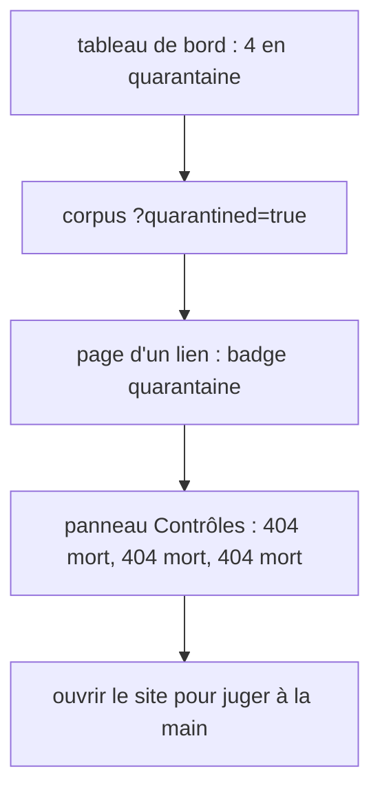
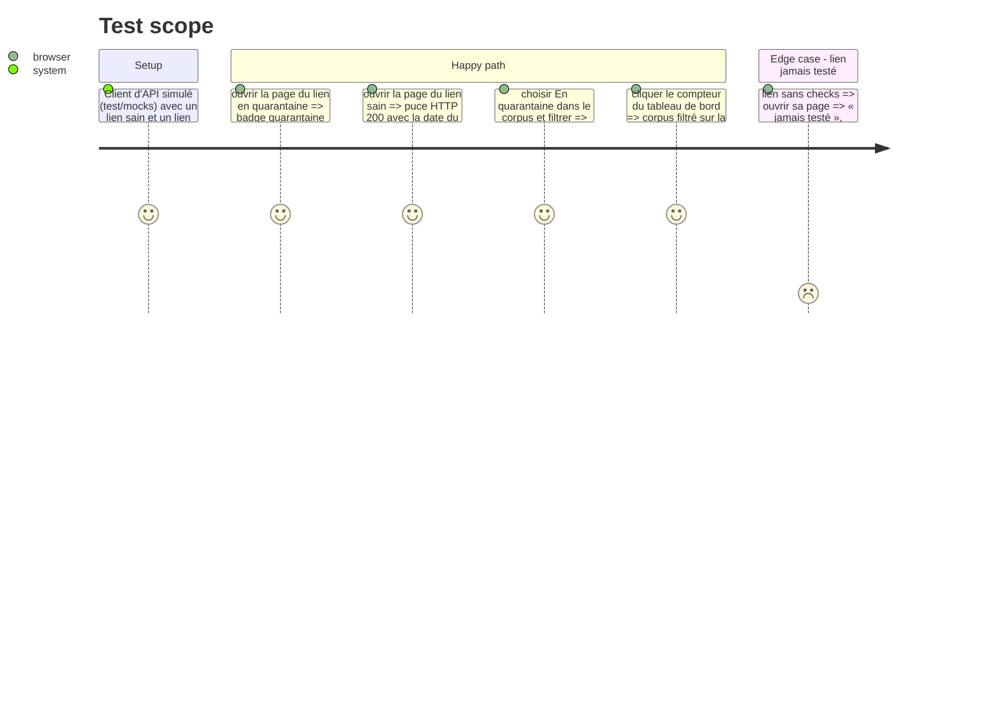

<!-- Fill or omit these sections; never add, rename, or reorder one. -->

# Instruction: datapool — quarantaine et historique des tests

## Architecture projection

> Tree of the final files. ✅ create · ✏️ modify · ❌ delete

```txt
datapool
├── src/lib/api/schema.d.ts            ✏️ régénéré (`pnpm api:types`) depuis openapi.json de webpool (phase 2)
├── src/lib/format.ts                  ✏️ checkVerdictLabel (sain, mort, incertain) ; checkErrorLabel (ENOTFOUND → domaine introuvable, TimeoutError → délai dépassé, TOO_MANY_REDIRECTS → trop de redirections, HOST_REFUSED → hôte refusé…, étiquette inconnue affichée telle quelle)
├── src/routes/urls/[id]/+page.svelte  ✏️ badge « quarantaine » ; puce « HTTP 200 · testé le … » lue dans `checks[0]` (à défaut, `http_status` de la normalisation, sans date) ; panneau « Contrôles » (10 derniers tests)
├── src/routes/corpus/+page.svelte     ✏️ filtre Quarantaine (toutes, hors quarantaine, en quarantaine) lu depuis `?quarantined=` ; marque dans la ligne d'un lien en quarantaine
├── src/routes/+page.svelte            ✏️ tableau de bord : compteur « en quarantaine », lien vers le corpus filtré
└── test/components.svelte.test.ts     ✏️ rendu du badge et du panneau Contrôles
```

## User Journey



## Test Scope



## Wireframe

```txt
┌─────────────────────────────────────────────────────────────────────┐
│ corpus / url #224                                                   │
│ ┌──────────────┐ [1] CLASSÉE  À qualifier  QUARANTAINE              │
│ │  vignette    │     HTTP 404 · testé le 6 nov. 04:12               │
│ │              │ [2] Titre du lien                                  │
│ └──────────────┘     https://…                                      │
│                      Ouvrir le site   Copier l'URL                  │
│ [3] Pertinence │ Qualité │ Confiance │ Domaine                      │
│ [4] Sources ─────────────────────────────────────────────────────── │
│ [5] Contrôles  3 morts comptés · en quarantaine depuis le 6 nov.    │
│ ┌───────────────────┬────────┬───────────┬────────────────────────┐ │
│ │ date              │ HTTP   │ verdict   │ erreur                 │ │
│ │ 6 nov. 04:12      │ 404    │ mort      │                        │ │
│ │ 5 nov. 04:09      │ —      │ incertain │ délai dépassé          │ │
│ │ 4 nov. 04:11      │ 404    │ mort      │                        │ │
│ │ 3 nov. 04:10      │ 404    │ mort      │                        │ │
│ └───────────────────┴────────┴───────────┴────────────────────────┘ │
│ [6] Thèmes │ Facettes │ Pools                                       │
└─────────────────────────────────────────────────────────────────────┘
```

1. Bandeau d'état : statut, usage, badge quarantaine si `quarantined_at`, dernier test (`checks[0]` : statut ou erreur, et date) ; lien jamais testé : `http_status` de la normalisation et « jamais testé ».
2. Titre, URL et actions, inchangés.
3. Scores et domaine, inchangés.
4. Sources, inchangées.
5. Contrôles : résumé (`dead_streak` morts comptés, un `incertain` entre deux ne rompant pas la série ; date de quarantaine) puis les 10 derniers tests.
6. Thèmes, facettes, pools, inchangés ; un lien en quarantaine n'a plus de pool.

## Tasks to do

### `1)` Types et libellés

> datapool lit les champs de la phase 2.

1. `pnpm api:types` après la fusion de la phase 2 dans webpool ; `checkVerdictLabel` et `checkErrorLabel` dans `format.ts`.

### `2)` Page d'un lien

> On voit pourquoi un lien est écarté.

1. Badge quarantaine, puce du dernier test, panneau Contrôles selon le wireframe ; styles dans les fichiers CSS existants (CSP sans style en ligne).

### `3)` Corpus et tableau de bord

> On retrouve les liens en quarantaine.

1. Filtre `quarantined` (présélection par l'URL, comme `?status=`) ; marque dans la ligne.
2. Compteur du tableau de bord depuis `stats.quarantined`, lien vers `/corpus?quarantined=true`.

## Test acceptance criteria

| Task | Acceptance criteria |
| ---- | ------------------- |
| 1 | `pnpm check` passe avec les types régénérés. |
| 2 | La page d'un lien en quarantaine montre le badge et ses tests avec verdict ; un lien sain montre son dernier statut et sa date ; un lien jamais testé s'affiche sans erreur. |
| 3 | Le filtre « en quarantaine » ne liste que ces liens et survit au rechargement par `?quarantined=true` ; le compteur du tableau de bord y mène. |
